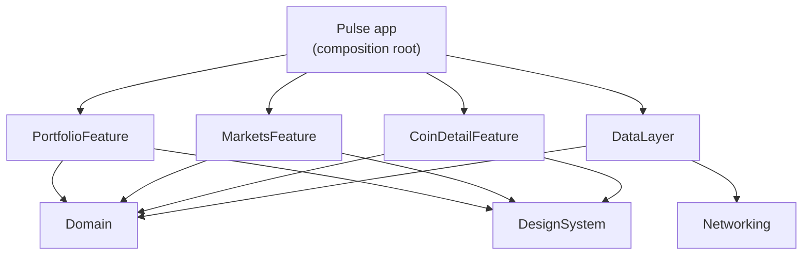

<p align="center">
  
</p>

<h1 align="center">Pulse</h1>

<p align="center">
  A crypto market and portfolio tracker for iPhone — built as a multi-module app with Clean Architecture, async/await and dependency injection.
</p>

<p align="center">
  
  
  
  
  
</p>

---

## Features

- **Live markets** — top 100 coins with price, 24h change and a 7-day sparkline, sortable by market cap, gainers, losers or volume.
- **Smart search** — instant local filtering ranked by relevance, plus debounced remote search for coins outside the top 100.
- **Interactive charts** — Swift Charts with 1D / 1W / 1M / 1Y ranges and press-and-drag scrubbing.
- **Works offline** — the last market list is cached and shown with an "offline" notice when the network fails.
- **Rate-limit friendly** — data younger than a minute is reused (CoinGecko only refreshes once a minute anyway); pull to refresh forces an update.
- **Portfolio** — add the coins you own and see the total balance, 24h profit/loss and an allocation donut chart. Stored on device with SwiftData.
- **Add from anywhere** — every coin screen has an "Add to portfolio" button that edits the existing amount if you already own the coin.
- **Locale-aware input** — amounts like `0,5` (Armenian, Russian, German) and `0.5` (English) are both understood.
- **Graceful degradation** — if live prices fail, the portfolio falls back to saved prices, and then to amounts only, with a clear notice.

## Architecture

The app target is a thin shell. All code lives in a local Swift package, **PulseKit**, split into modules with one-way dependencies:



| Module | Responsibility | Depends on |
|---|---|---|
| `Domain` | Entities (`Coin`, `Holding`, `PortfolioSummary`…), the `MarketRepository` and `HoldingsRepository` contracts, and pure business rules (`MarketRules`, `PortfolioCalculator`, `AmountParser`). Foundation only. | — |
| `Networking` | Generic `APIClient` + `HTTPClient` protocol; maps failures to `NetworkError`. Knows nothing about crypto. | — |
| `DataLayer` | CoinGecko DTOs and mappers, `DefaultMarketRepository`, file-based offline cache, SwiftData holdings store. Translates transport errors into domain errors; SwiftData never leaks out of this module. | Domain, Networking |
| `DesignSystem` | Colors, number formatting, reusable views (`Sparkline`, `ChangeBadge`, `CoinIcon`…). | — |
| `MarketsFeature` | Market list, search and sorting (`MarketsViewModel` + views). | Domain, DesignSystem |
| `CoinDetailFeature` | Price chart and stats (`CoinDetailViewModel` + views). | Domain, DesignSystem |
| `PortfolioFeature` | Balance, allocation chart, holdings list and the add/edit sheet. | Domain, DesignSystem |

### Key decisions

- **Dependency rule** — features depend on `Domain` protocols, never on `DataLayer`. Only the app's `AppContainer` knows the concrete types, so every feature can be tested with a fake repository.
- **Features don't import each other** — rows push a `CoinIdentity` and the app decides which screen that opens. The "Add to portfolio" button on the coin screen is attached by the app, so `CoinDetailFeature` and `PortfolioFeature` stay independent.
- **Business math is pure** — `PortfolioCalculator` turns holdings + prices into totals, 24h change and allocation with no I/O, so every edge case (missing prices, tiny holdings grouped into "Other") is a fast unit test.
- **Constructor injection, no singletons** — view models receive their dependencies through `init`.
- **Errors are translated at the boundary** — HTTP status codes stay in `Networking`/`DataLayer`; features only see `MarketDataError` (`offline`, `rateLimited`, `unavailable`) and turn it into a human message.
- **async/await throughout** — debounced search uses `.task(id:)` cancellation instead of Combine; late search responses for an outdated query are ignored.

## Tests

Each module has its own test target, runnable without a simulator app:

- `DomainTests` — filtering relevance, sorting, change calculations, search use case, portfolio math, locale-aware amount parsing.
- `NetworkingTests` — URL building, headers, snake_case decoding, 429 / 5xx / offline / cancellation handling.
- `DataLayerTests` — decoding real CoinGecko JSON (including `null`s), mapping, cache freshness, offline fallback, error translation, file cache round trip, SwiftData upsert/delete (in-memory store).
- `MarketsFeatureTests` / `CoinDetailFeatureTests` / `PortfolioFeatureTests` — view model behavior against scriptable fakes (`FakeMarketRepository`, `FakeHoldingsRepository`).

In Xcode, **⌘U** on the `Pulse` scheme runs every module's tests with code coverage.

CI runs every module's tests and builds the app on each push.

## Getting started

Requirements: Xcode 16+, iOS 17+.

```bash
brew install xcodegen      # once
git clone https://github.com/Irenapoghosian/pulse-crypto.git
cd pulse-crypto
xcodegen
open Pulse.xcodeproj
```

The app works without an API key using CoinGecko's keyless API. For a higher rate limit, get a free Demo key and:

```bash
cp Config/Secrets.example.xcconfig Config/Secrets.xcconfig   # then paste your key
```

`Secrets.xcconfig` is git-ignored.

Market data provided by [CoinGecko](https://www.coingecko.com).

## Roadmap

- [x] Markets list with search, sorting and offline cache
- [x] Coin detail with interactive charts
- [x] Portfolio with SwiftData persistence
- [ ] Widgets

## License

MIT — see [LICENSE](LICENSE).

## Author

**Irena Poghosyan** — iOS developer · [GitHub](https://github.com/Irenapoghosian)
